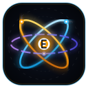

<div align="center">



# ELEMENTA
### Research-Grade Scientific Visualization & Physics Simulation Suite

[](#)
[](#-automated-verification--test-suite)
[](#-technical-stack--architecture)
[](#-technical-stack--architecture)
[](#-design-philosophy)
[](#)

**[Explore Live Demo](http://localhost:3520)** · **[Feature Specification](./FEATURES.md)** · **[Report Issue](https://github.com/kumarlokesh16693/elementa/issues)**

</div>

---

## 🌌 Overview

**ELEMENTA** is an interactive, research-grade computational physics and chemistry laboratory suite engineered entirely on the **`nexus-framework`** and **`@nexus/3d`**.

Designed for researchers, educators, and university students, ELEMENTA covers atomic physics, quantum wave mechanics, molecular orbital theory, solid-state crystallography, nuclear astrophysics, and radiation protection.

> [!NOTE]
> **Zero React Runtime Overhead**: ELEMENTA is implemented with 100% native virtual DOM and reactive state primitives (`h`, `mount`, `patch`, `effect`, `reactive`), utilizing Tailwind CSS and custom autonomous Web Components.

---

## 🏛️ Application Modules

| Route | Module | Primary Physical Domain | Native Nexus Custom Elements |
| :--- | :--- | :--- | :--- |
| **`/index.html`** | **Periodic Table & Atomic Lab** | Atomic Physics, Crystallography, NIST Spectroscopy | `<elementa-bohr-3d>`, `<elementa-crystal-view>`, `<elementa-spectra-view>` |
| **`/orbitals.html`** | **Quantum Mechanical Orbital Lab** | Hydrogen-like Wavefunctions, Perturbation Theory | `<elementa-orbital-view>`, `<elementa-zeeman-stark-modal>` |
| **`/mo.html`** | **Molecular Orbital & Vibrational Lab** | LCAO-MO Theory, VSEPR Geometry, IR/Raman Spectra | `<elementa-vsepr-view>`, `<elementa-vibration-view>` |
| **`/segre.html`** | **Segrè Chart of the Nuclides** | Nuclear Decay, Fission/Fusion, Radiation Shielding | `<elementa-segre-view>`, `<elementa-bateman-modal>`, `<elementa-semf-modal>`, `<elementa-nucleosynthesis-modal>`, `<elementa-shielding-modal>` |
| **`/daedalus.html`** | **Project Daedalus Flight Simulator** | Hypersonic Re-entry, Aerothermodynamics | `<elementa-daedalus-sim>` |
| **`/references.html`** | **CODATA Reference & Citations** | Precision Metrology, SI Base Units, BibTeX | Native virtual DOM |
| **`/integrity.html`** | **Cryptographic Data Audit** | NIST / IAEA Data Authenticity Verification | Native virtual DOM |

---

## 🔬 Deep-Dive Physics Engines

### 1. ⚡ Zeeman & Stark Effect Quantum Splitting Lab (`/orbitals.html`)
- **Magnetic Field $B$ Perturbations ($0 \to 10\,\text{Tesla}$)**:
  - Analytical Landé $g$-factor:
    $$g_J = 1 + \frac{j(j+1) + s(s+1) - l(l+1)}{2j(j+1)}$$
  - Weak-field Zeeman splitting ($\Delta E = g_J \mu_B B m_j$) transitioning smoothly via Breit-Rabi formula into the **Paschen-Back uncoupling regime** ($\Delta E \to \mu_B B (m_l + 2m_s)$).
- **Electric Field $E$ Perturbations ($0 \to 100\,\text{kV/cm}$)**:
  - First-order Linear Stark splitting in hydrogen $n=2$ ($\Delta E = \pm 3 e a_0 E_{\text{ext}}$).
  - Second-order Quadratic Stark polarization ($\Delta E = -\frac{1}{2}\alpha E^2$).
  - Real-time 2D electron cloud cross-section visualizing $|2s\rangle-|2p_z\rangle$ parity mixing and permanent induced dipole formation $\mathbf{p} = \alpha \mathbf{E}$.
- **Polarized Spectrogram**: Live rendering of $\pi$ ($\Delta m_j=0$, parallel $E \parallel B$) and $\sigma^\pm$ ($\Delta m_j=\pm 1$, circularly polarized) optical transitions.

---

### 2. 🛡️ Radiation Shielding & Particle Attenuation Lab (`/segre.html`)
- **Beer-Lambert Attenuation**:
  $$I(x) = I_0 e^{-\mu x} = I_0 e^{-(\mu / \rho) (\rho x)}$$
  Dynamic calculations of Half-Value Layer ($\text{HVL} = \frac{\ln 2}{\mu}$) and Tenth-Value Layer ($\text{TVL} \approx 3.322 \times \text{HVL}$).
- **Energy-Dependent Interaction Regimes ($\mu = \tau + \sigma_c + \kappa$)**:
  - Photoelectric Absorption ($\tau \propto Z^4 / E^{3.2}$) dominating $< 0.2\,\text{MeV}$.
  - Compton Scattering ($\sigma_c$) dominating $0.3 - 5.0\,\text{MeV}$.
  - Pair Production ($\kappa \propto \ln(E/1.022)$) emerging strictly above $2 m_e c^2 = 1.022\,\text{MeV}$.
- **Charged Particle Stopping Power & Bragg Peak**:
  - Bethe-Bloch electronic stopping power $-\frac{dE}{dx}$ for alpha particles and protons, demonstrating the concentrated terminal ionization peak utilized in hadron therapy.
  - Katz-Penfold beta particle range $R_\beta$ and Bremsstrahlung radiative yield $Y \approx \frac{Z E_\beta}{3000\,\text{MeV}}$.
- **ALARA Dosimetry (ICRP 103)**: Equivalent dose rates ($\mu\text{Sv/h}$) with inverse-square distance scaling.

---

### 3. 🔬 Liquid-Drop SEMF & Nuclear Fission / Fusion Energetics (`/segre.html`)
- **Bethe-Weizsäcker Semi-Empirical Mass Formula (SEMF)**:
  $$B(A, Z) = a_v A - a_s A^{2/3} - a_c \frac{Z(Z-1)}{A^{1/3}} - a_a \frac{(A - 2Z)^2}{A} + \delta(A, Z)$$
- **Bohr-Wheeler Fissility**: Fissility parameter $x = \frac{Z^2 / A}{50.883}$, Coulomb fragment repulsion ($\sim 239\,\text{MeV}$), and prompt $Q$-value distributions.
- **Thermonuclear Fusion vs Fission**: $D\text{-}T$ ($17.59\,\text{MeV}$), $D\text{-}D$, and $p\text{-}^{11}B$ reaction energetics.

---

### 4. ⏱️ Bateman Radioactivity Decay Solver (`/segre.html`)
- **Coupled Differential Equations Solver**:
  $$N_n(t) = \sum_{i=1}^n c_i e^{-\lambda_i t}, \quad c_i = \frac{N_1(0) \prod_{j=1}^{n-1} \lambda_j}{\prod_{j=1, j \ne i}^n (\lambda_j - \lambda_i)}$$
- Analytical verification of secular and transient equilibria ($t_{\max} = \frac{\ln(\lambda_2 / \lambda_1)}{\lambda_2 - \lambda_1}$).
- 15-member complete actinide decay chains ($^{238}\text{U} \to {}^{206}\text{Pb}$).

---

### 5. ✦ Stellar Nucleosynthesis & Cosmic Origins (`/segre.html`)
- **6 Stellar Burning Epochs**: Proton-Proton chains, CNO catalytic cycle ($Q = 26.73\,\text{MeV}$), and Triple-Alpha Hoyle state resonance ($7.654\,\text{MeV}$).
- **Neutron Capture**: Slow ($s$-process) up to $^{209}\text{Bi}$ and Rapid ($r$-process) actinide synthesis in kilonovae.
- **Solar Gamow Peak**: Quantum tunneling integration demonstrating solar fusion at $E_0 \approx 6.07\,\text{keV}$.

---

### 6. 🌐 3D VSEPR & Vibrational Spectroscopy (`/mo.html`)
- **VSEPR Geometries**: Steric numbers 2 to 6, lone pair angular repulsion, and net dipole cancellation.
- **FTIR & Raman Spectrometer**: Normal vibration modes with Center-of-Mass conservation ($\sum m_i \Delta \mathbf{r}_i = \mathbf{0}$) and strict Rule of Mutual Exclusion for centrosymmetric molecules ($C_i, D_{\infty h}, O_h, D_{4h}$).

---

### 7. 💎 Solid-State Crystallography & Powder XRD (`/index.html`)
- **Lattices**: FCC, BCC, HCP, Diamond, Simple Cubic, NaCl, and ZnS.
- **Miller Index Slicing**: Dynamic 3D slicing planes $(h, k, l)$ with $d$-spacing calculations.
- **Synthetic Powder XRD**: Bragg's law ($\lambda = 2d \sin\theta$) with structure factor $F_{hkl}$ systematic extinction rules.

---

## 🧪 Automated Verification & Test Suite

All physics, mathematics, and numerical algorithms are continuously validated against evaluated empirical datasets (NIST, IAEA, CODATA):

```bash
# Run all 8 test suites
npx tsx scripts/test-zeeman-stark.ts
npx tsx scripts/test-shielding.ts
npx tsx scripts/test-semf.ts
npx tsx scripts/test-bateman.ts
npx tsx scripts/test-nucleosynthesis.ts
npx tsx scripts/test-vibrations.ts
npx tsx scripts/test-crystallography.ts
npx tsx scripts/test-vsepr.ts
```

```
=== TEST SUMMARY ===
✓ Zeeman & Stark Quantum Splitting: 24 / 24 passed
✓ Radiation Shielding Lab:         20 / 20 passed
✓ Liquid-Drop SEMF & Fission:      22 / 22 passed
✓ Bateman Decay Simulator:         16 / 16 passed
✓ Stellar Nucleosynthesis:         17 / 17 passed
✓ Molecular Vibrations Lab:        44 / 44 passed
✓ Solid-State Crystallography:     21 / 21 passed
✓ 3D VSEPR Molecular Geometry:     17 / 17 passed
===================================================
Total: 181 passed, 0 failed (100% pass rate)
```

---

## 🚀 Getting Started

### Prerequisites
- [Node.js](https://nodejs.org/) (v18.0.0 or higher recommended)
- `npm` or `pnpm`

### Installation
Clone the repository and install dependencies:

```bash
git clone https://github.com/kumarlokesh16693/elementa.git
cd elementa
npm install
```

### Development Server
Start the local development server at `http://localhost:3520`:

```bash
npm run dev
```

### Production Build
Verify type integrity and compile the multi-page production bundle:

```bash
npm run build
```

Compiled static assets are generated into `dist/` with relative portability (`base: './'`), ready for deployment to any static hosting provider.

---

## 🛠️ Technical Stack & Architecture

- **Core Framework**: [`nexus-framework`](https://github.com/kumarlokesh16693/nexus-framework) (Virtual DOM, fine-grained reactive state, lifecycle hooks)
- **3D Graphics Engine**: `@nexus/3d` (Hardware-accelerated WebGL / WebGPU scene graphs, procedural geometries, custom shaders, OrbitControls)
- **Styling**: Tailwind CSS
- **Language**: TypeScript (Strict typing, zero `any` compromises)
- **Bundler**: Vite (Fast HMR, multi-entry HTML rollups)

---

## 📜 Design Philosophy

1. **Pedagogical Integrity**: Models strictly differentiate between classical analogies (e.g. Bohr orbits) and quantum mechanical realities (probability densities, Schrödinger wavefunctions).
2. **Empirical Grounding**: Nuclear values are anchored to IAEA LiveChart/ENSDF (2023 evaluation); physical constants derive from CODATA 2022.
3. **Zero Third-Party Component Overhead**: Eliminates heavy UI frameworks and React component bloat, providing responsive, instant rendering on any device.

---

## 📄 License

Distributed under the MIT License. See [LICENSE](LICENSE) for more information.
